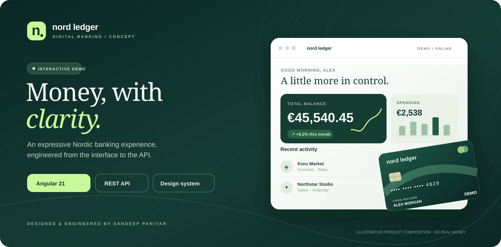

# Nord Ledger

**A calmer way to see, move, and manage money.**

[](https://sandeepariyar.github.io/NORD-LEDGER-Angular21-Banking-Platform/)

### [Try the live banking experience](https://sandeepariyar.github.io/NORD-LEDGER-Angular21-Banking-Platform/) &nbsp; · &nbsp; [Explore the design system](https://sandeepariyar.github.io/NORD-LEDGER-Angular21-Banking-Platform/design-system/) &nbsp; · &nbsp; [Browse the REST API](#rest-endpoints)

> **PORTFOLIO CONCEPT / ANGULAR 21 / REST API / DESIGN SYSTEM**  
> Designed and engineered by **Sandeep Pariyar**.

Nord Ledger is an original, interactive Nordic digital banking concept. Its Angular 21 interface, JavaScript REST API, and component foundations are developed together as a coherent product experience. The demo makes fictional transfers, card customization, profile settings and spending insights genuinely interactive.

The hero above is an *illustrative product composition*. Open the live app to explore the actual implementation. No real banking services, financial transactions, card numbers, private identity data, or customer accounts are involved.

## Design language

Deep forest, considered spacing, an expressive editorial type accent, and a restrained lime signal establish an interface designed around clarity and trust. The design system is a distinct part of this repository, with source-shared tokens and reusable controls used by the product and its component explorer.

| Foundation | Implementation |
| --- | --- |
| **Color & semantics** | Forest `#10332D`, lime `#C6F78D`, canvas `#F4F6F3`, surfaces and feedback roles |
| **Card expression** | Nordic, Aurora and Carbon visual finishes, common card anatomy |
| **Control behavior** | Focus, hover, loading, disabled, validation and toggle states |
| **Product patterns** | Navigation, balance summaries, transactions, forms, feedback and responsive grids |

[View source tokens](src/design-system/tokens.css) · [Component primitives](src/design-system/components.css) · [Design-system documentation](design-system/README.md)

## What works

- Five responsive sections: Overview, Accounts, Payments, Insights and Cards, plus a Profile & Settings drawer.
- Account data and transaction history fetched from the REST API.
- Account-to-account transfers with funds checks and idempotency keys.
- New transfer records visible immediately, with both debit and credit entries.
- Card freeze/unfreeze, online/contactless/international payment switches, and daily spending limits through PATCH endpoints.
- A Card Design Studio with Nordic, Aurora and Carbon finishes, live preview, tilt and front/back flip. Only fictional, masked card information is shown.
- A Card Collection flow with five product concepts (Everyday, Travel, Virtual, Premium and Credit Concept), product comparison, linked demo account selection, finish customization and review.
- Issue optional fictional cards from the REST API, view card-management event history, close optional cards and reissue them later. Original Everyday and Travel cards cannot be removed.
- Editable demo profile name, email, interface language and notification preferences through the REST API; cardholder labels update when the profile name changes.
- A Security tab to explore fictional security preferences. Its switches are **illustrative only** and do not provide authentication, device enrollment or a real security guarantee.
- Transaction search, account filtering, CSV export and demo reset.
- Spending distribution, weekly illustration and budget comparison.
- Loading, success, empty and error states, plus keyboard-friendly controls.
- A standalone Nord Ledger Design System explorer with live component states and source-shared tokens.

## Stack

- Angular 21 standalone components and signals
- TypeScript, RxJS and Angular `HttpClient`
- Native CSS design system (tokens, component states, responsive layout)
- Framework-neutral design primitives shared between the Angular product and a dedicated `/design-system` showcase
- JavaScript REST API bundled as Cloudflare Worker ESM
- No third-party UI kits or charting dependencies

## Start locally

Requires Node.js compatible with Angular 21 and npm.

```bash
npm install
npm run build
npm run dev
```

Open `http://localhost:3000` to use the fully functional frontend + API together. To develop Angular UI only, `npm start` runs the Angular dev server but does **not** proxy API requests. Rebuild before starting the full-stack local server to include the latest UI code.

Run API smoke tests after building:

```bash
npm test
```

Design-system source is under `src/design-system/`, with the browsable explorer under `design-system/`. The build copies the shared CSS to the explorer and bundles everything into the same Worker. Visit `http://localhost:3000/design-system` after `npm run dev`.

## REST endpoints

| Method | Route | Behavior |
| --- | --- | --- |
| `GET` | `/api/health` | API health and version |
| `GET` | `/api/overview` | Create or resume demo session and return overview |
| `GET` | `/api/accounts` | Read account balances |
| `GET` | `/api/transactions?account=everyday` | Search account transactions by account ID |
| `GET` | `/api/cards` | Read fictional cards |
| `GET` | `/api/card-products` | Read the available card collection and eligibility options |
| `POST` | `/api/cards` | Add a new optional fictional card to the demo wallet |
| `GET` | `/api/cards/:id/activity` | Read demo card-management events, not purchase transactions |
| `DELETE` | `/api/cards/:id` | Close an optional card; original cards remain protected |
| `GET` | `/api/profile` | Read the fictional customer profile and preferences |
| `PATCH` | `/api/profile` | Update name, email, language, notifications and security-preview preferences |
| `PATCH` | `/api/cards/:id` | Freeze, change finish, set daily limit or configure payment switches |
| `GET` | `/api/insights` | Spending and budget illustration |
| `POST` | `/api/transfers` | Validate and transfer between own demo accounts |
| `POST` | `/api/reset` | Restore original fictional data, even after a demo session expires |

`GET /api/overview` returns `X-Demo-Session`, which must be sent to other endpoints. Transfers additionally require an `Idempotency-Key` header and JSON body:

```json
{
  "fromAccountId": "everyday",
  "toAccountId": "savings",
  "amount": 25.50
}
```

Card changes use `PATCH /api/cards/:id` with fields such as `{"designId":"carbon","dailyLimitCents":150000,"controls":{"online":false}}`. The API validates requested changes before applying them. These are simulated switches: they never authorize or block real-world payments.

Card collection checkout uses `POST /api/cards` with `{ "productId": "virtual-debit", "accountId": "everyday", "designId": "carbon" }`. Valid product IDs are `virtual-debit`, `premium-debit` and `credit-concept` for optional cards. An optional product can appear only once at a time in a session. The Credit Concept is strictly an interface demonstration: **there is no lending, credit application, approval, debt, interest or real credit limit**.

## Safety and scope

**Not a bank or banking-grade reference architecture.** The backend uses temporary, per-session in-memory demo data, which can reset when a Worker instance restarts. It has no persistent database, user authentication, account ownership verification, card-issuing processor, payment rails, compliance controls, encryption-at-rest claims, or audit-grade ledger. Card activity is management-event history, not a purchase ledger. The Profile Security controls are UI demonstrations, not implemented protections. All names, balances and card details are invented. To make this production-capable, you would need regulated financial infrastructure, database-backed double-entry accounting, strong auth, authorization, audit logging, rate limits, reconciliation, secrets management, and dedicated security review.

## Deployment structure

`npm run build` compiles Angular into `dist/angular/browser`, then embeds those assets in `dist/server/index.js`, alongside same-origin REST routes. The generated Worker is what the Site deploys; source is under `src/` and `worker/`.

### Public GitHub Pages preview

The [live GitHub Pages preview](https://sandeepariyar.github.io/NORD-LEDGER-Angular21-Banking-Platform/) builds the **real Angular application**, not a screenshot or a non-functional mockup. The [Pages workflow](.github/workflows/pages.yml) runs the Angular production build and API checks, then publishes the compiled client and design-system explorer under the repository's GitHub Pages path.

GitHub Pages is static hosting and cannot execute a Worker. Accordingly, the published Angular client calls the public **Nord Ledger demo REST API** hosted by the companion Cloudflare Worker at `nord-ledger-angular-bank-demo.sandeep-pariyar.chatgpt.site`. The Worker accepts browser CORS requests only from `https://sandeepariyar.github.io` and exposes the temporary `X-Demo-Session` response header. The API's own same-origin deployment remains available as well. Temporary state is held per demo session and may reset on Worker restart.

To build the GitHub Pages variant locally:

```bash
npm ci
npm run build -- --base-href=/NORD-LEDGER-Angular21-Banking-Platform/
npm test
```

For a release or review, verify transfers, card changes, and reset against the live REST backend after the GitHub Pages deployment finishes.

Designed and engineered as an original fintech interface demo.

© 2026 Sandeep Pariyar. All rights reserved. See [Copyright and use](COPYRIGHT.md). Public source visibility does not grant an open-source license.
